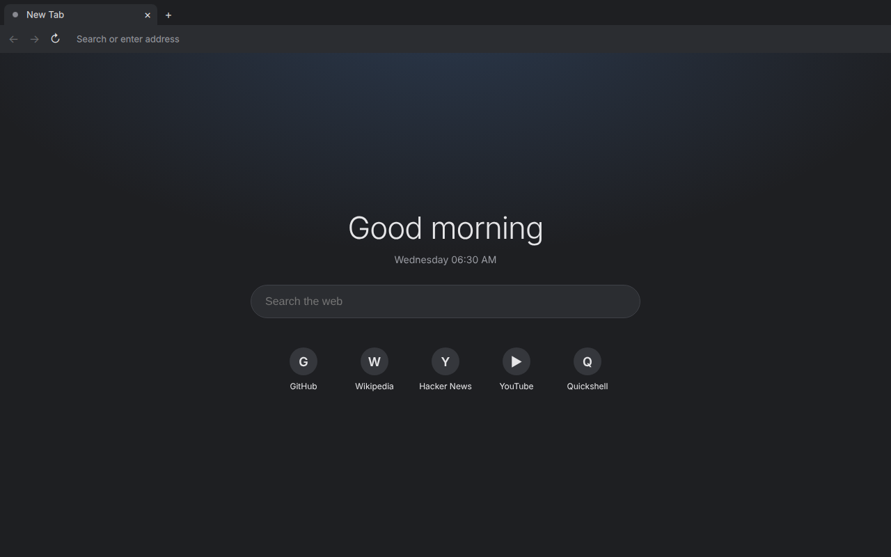
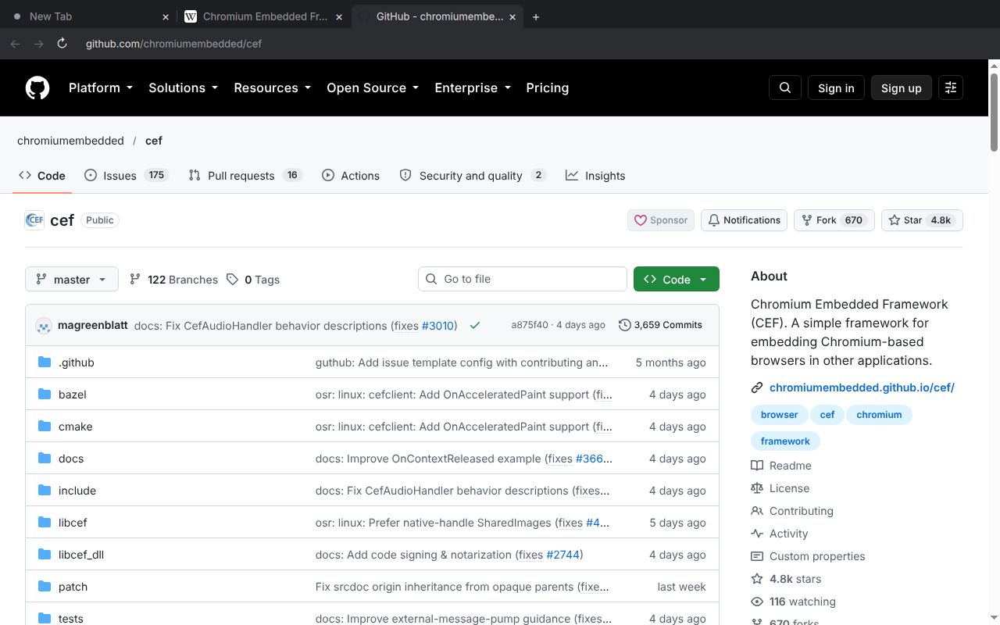
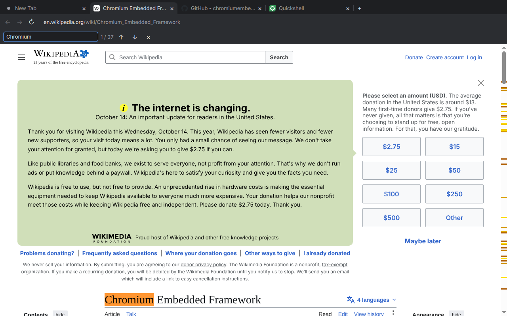
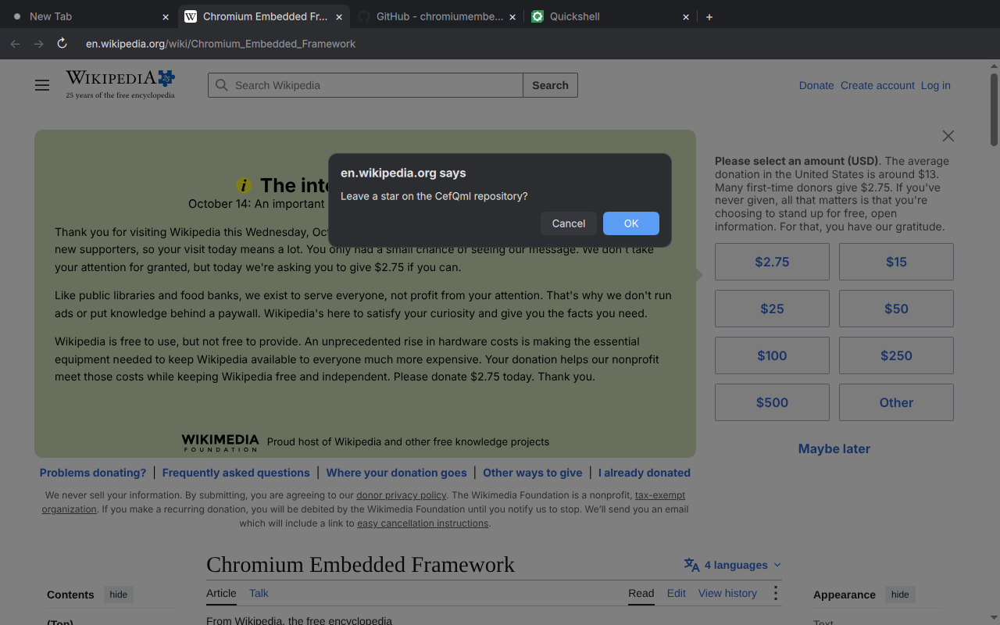

# cef-qml

QML bindings for the [Chromium Embedded Framework](https://github.com/chromiumembedded/cef)
(CEF), rendered off-screen into Qt Quick.

cef-qml gives you the primitives to build **your own web browser in QML**, the
way [Quickshell](https://quickshell.outfoxxed.me/) gives you the primitives to
build your own desktop shell: a Chromium web view item, decision requests
(dialogs, permissions, file pickers, downloads), DevTools-protocol scripting
and live QML reloading, plus a library of ready-made browser building blocks
(tabs, address bar, find bar, ...). A complete reference browser built from
those blocks is included.

```qml
import QtQuick
import QtQuick.Window
import CefQml

Window {
    width: 1024; height: 768; visible: true
    CefWebView { anchors.fill: parent; url: "https://example.com"; focus: true }
}
```

| | |
|---|---|
|  |  |
|  |  |

*The reference browser (`examples/browser/`): new-tab page, a site, find in
page, and a `confirm()` dialog drawn by `RequestOverlay`.*

Contents: [Install](#install) · [Quickstart](#quickstart) ·
[`CefQml` API](#cefqml-module-api) · [`CefQml.Components`](#cefqmlcomponents) ·
[Sessions](#sessions) · [Hot reload](#hot-reload) · [Remote control (CDP)](#remote-control-chrome-devtools-protocol) ·
[Environment variables](#environment-variables) · [Limitations](#limitations) ·
[Testing](#testing) · [License](#license)

## Install

Linux x86_64 only. Requires Qt 6 (tested with Qt 6.4.2, Ubuntu 24.04) with
Qt Quick; the browser itself (CEF 154 / Chromium 154, minimal distribution)
ships with cef-qml.

### Prebuilt tarball

Download `cef-qml-<version>-linux-x86_64.tar.gz` from the
[releases page](https://github.com/gartnera/cef-qml/releases) and extract it
anywhere:

```sh
tar xf cef-qml-0.1.0-linux-x86_64.tar.gz      # creates ./cef-qml/
export QML_IMPORT_PATH=$PWD/cef-qml/qml
/usr/lib/qt6/bin/qml cef-qml/share/cef-qml/examples/browser/main.qml
```

The tree is relocatable; the plugin finds Chromium relative to itself, so
`QML_IMPORT_PATH` is the only thing to set:

```
cef-qml/
  qml/CefQml/                 QML plugin, qmldir, Components/ (CefQml.Components)
  lib/cef-qml/                libcef.so, Chromium resources, locales/, cef-qml-helper
  share/cef-qml/examples/     reference browser
  README.md  BUILDINFO  LICENSES/
```

The tarball is built against Qt 6.4 on Ubuntu 24.04. The plugin only uses
public Qt API, so later Qt 6 releases should load it as well (Qt keeps binary
compatibility within Qt 6), but only Qt 6.4 is tested. Chromium needs the usual
desktop libraries (`libnss3`, `libasound2`, `libgbm1`, `libxkbcommon0`, ...);
any system that runs Chrome has them. Use glibc malloc (see
[Limitations](#limitations)).

### Build from source

```sh
# Ubuntu 24.04
sudo apt install meson ninja-build g++ pkg-config qt6-base-dev qt6-declarative-dev \
  qml6-module-qtquick qml6-module-qtquick-window qml6-module-qtqml-workerscript \
  qml6-module-qttest qml-qt6 qt6-declarative-dev-tools
meson setup build            # downloads the CEF minimal distribution (~310 MB)
meson compile -C build
QML_IMPORT_PATH=build /usr/lib/qt6/bin/qml examples/browser/main.qml
```

Requires Meson >= 1.3. The complete package list CI uses, including the Wayland
test suite's `weston` and `qt6-wayland`, is
[`.github/apt-packages.txt`](.github/apt-packages.txt).

The build tree is directly usable (`QML_IMPORT_PATH=<builddir>`), and
`meson install` installs the module into `<libdir>/qt6/qml` and the runtime
into `<libdir>/cef-qml`. Options (`meson configure`): `qml_dir`,
`runtime_dir`, `examples`. When both directories are inside the prefix the
plugin's RPATH is relative (`$ORIGIN/...`), so the whole prefix can be moved;
`scripts/make-release.sh` builds the release tarball that way. Contributor
notes: [docs/DEVELOPMENT.md](docs/DEVELOPMENT.md).

Optional: `qml6-module-qtquick-dialogs` lets the reference browser answer
`<input type=file>` with Qt's file dialog (otherwise file pickers are
canceled).

## Quickstart

### A web view

```qml
import QtQuick
import QtQuick.Window
import CefQml

Window {
    width: 1024; height: 768; visible: true
    title: web.title

    CefWebView {
        id: web
        anchors.fill: parent
        focus: true
        url: "https://example.com"
        onLoadFinished: (url, status) => console.log("loaded", url, status)
        onNewWindowRequested: (url, userGesture, background) => web.url = url
    }
}
```

`CefWebView` handles mouse, wheel, keyboard and IME input, the clipboard
(through Qt's clipboard), `<select>` popups, tooltips and cursors. Hidden
views (`visible: false` or `active: false`) stop rendering.

### Scripting

```qml
CefWebView {
    id: web
    url: "https://example.com"

    // Run in every document before the page's own scripts.
    userScripts: ["document.addEventListener('DOMContentLoaded', () => console.log('hi'))"]
    onConsoleMessage: (level, message, source, line) => console.log("page:", message)

    onLoadFinished: {
        // Evaluate JavaScript; promises are awaited, the result comes back as JSON.
        web.evaluateJavaScript("document.querySelectorAll('a').length",
                               (result, error) => console.log("links:", result, error))
        // Any Chrome DevTools Protocol method...
        web.devToolsMethod("Page.captureScreenshot", { format: "png" },
                           (result, error) => shot.source = "data:image/png;base64," + result.data)
    }

    // ...and its events (enable the domain first).
    Component.onCompleted: web.devToolsMethod("Network.enable")
    onDevToolsEvent: (method, params) => {
        if (method === "Network.requestWillBeSent") console.log(params.request.url)
    }
}
Image { id: shot }
```

### Answering requests

Connect a handler to take over a decision; leave it unconnected for the
default (JavaScript dialogs dismissed, permissions denied, file dialogs
canceled, downloads saved to the user's download directory).

```qml
CefWebView {
    onJavaScriptDialogRequested: dialog => {
        if (dialog.type === CefJavaScriptDialog.Confirm) dialog.accept()
        else dialog.reject()
    }
    onPermissionRequested: request => request.origin.toString().startsWith("https://meet.example")
                                      ? request.grant() : request.deny()
    onFileDialogRequested: request => request.accept(["/home/me/report.pdf"])
    onDownloadRequested: download => download.accept("/tmp/downloads/")
}
```

### A whole browser

```qml
import QtQuick
import QtQuick.Window
import CefQml.Components

Window {
    width: 1280; height: 820; visible: true
    title: browser.title
    color: Style.background
    Component.onCompleted: Style.accent = "#e0a"   // theme every component

    Browser {
        id: browser
        anchors.fill: parent
        focus: true
        initialUrls: ["https://example.com", "https://github.com"]
    }
}
```

Or compose your own from the pieces:

```qml
import QtQuick
import QtQuick.Window
import CefQml
import CefQml.Components

Window {
    width: 1280; height: 820; visible: true
    Column {
        anchors.fill: parent
        TabStrip { id: strip; width: parent.width; tabs: tabs; onNewTabRequested: tabs.openTab("https://duckduckgo.com") }
        NavigationBar { id: nav; width: parent.width; view: tabs.currentView }
        WebTabs {
            id: tabs
            width: parent.width; height: parent.height - strip.height - nav.height
            Component.onCompleted: openTab("https://example.com")
            RequestOverlay { anchors.fill: parent; tabs: tabs }
        }
    }
}
```

## `CefQml` module API

`import CefQml` (version 1.0).

### `CefWebView` (Item)

A Chromium browser rendered off-screen into a Qt Quick texture. The browser is
created when the item is completed; it starts on an internal `about:blank`
page while user scripts are registered, then loads `url`.

| Property | Type | | Description |
|---|---|---|---|
| `url` | url | read/write | Current URL; setting it navigates. Follows in-page navigation. |
| `title` | string | read/write | Page title. Writing sets a placeholder (e.g. a restored tab's saved title) until the page reports its own. |
| `icon` | url | read/write | Favicon URL. Writable like `title`. |
| `loading` | bool | read-only | A navigation is in progress. Wait for `false` before inspecting the page. |
| `loadProgress` | real | read-only | 0..1. |
| `canGoBack`, `canGoForward` | bool | read-only | History state. |
| `hoveredUrl` | string | read-only | Link under the mouse (status text). |
| `tooltip` | string | read-only | Tooltip requested by the page. |
| `zoomFactor` | real | read/write | Page zoom, clamped to 0.25..5 (default 1). |
| `audioMuted` | bool | read/write | Mute the page. |
| `fullscreen` | bool | read-only | The page requested fullscreen (`element.requestFullscreen()`); resize the view accordingly. |
| `backgroundColor` | color | read/write | Default page background (default white). Only applies before the browser is created; use `"transparent"` for see-through pages. |
| `frameRate` | int | read/write | Maximum frames per second, 1..240 (default 60). |
| `active` | bool | read/write | `false` keeps the browser alive but stops rendering (as does `visible: false`). |
| `ready` | bool | read-only | The underlying CEF browser exists. |
| `discarded` | bool | read/write | `true` frees the browser (memory, processes) but keeps `url`, `title`, `icon`, `zoomFactor`, `audioMuted` and `userScripts`; `false` (or `reload()`) creates it again and loads `url`. Declared `true`, no browser is created until it turns `false`. Back/forward history and page state are lost; pending `devToolsMethod`/`evaluateJavaScript` calls are dropped, so re-run setup on `discardedChanged()`. |
| `frameCount` | int | read-only | Frames received so far (notifies through `frameSwapped`). |
| `userScripts` | list&lt;string&gt; | read/write | JavaScript sources run in every new document before the page's own scripts (`Page.addScriptToEvaluateOnNewDocument`). |

Enum `CefWebView.ConsoleLevel`: `Debug`, `Info`, `Warning`, `Error`.

| Method | Description |
|---|---|
| `goBack()`, `goForward()` | Navigate history. |
| `list navigationHistory()` | The back/forward list, oldest first: `[{ url, title, displayUrl, httpStatusCode, current, time }]` (`time`: a `Date`, when loaded). Empty without a browser. |
| `bool goToHistoryEntry(int index)` | Go to entry `index` of `navigationHistory()`. |
| `reload()`, `reloadIgnoringCache()`, `stop()` | |
| `loadHtml(string html)` | Load an HTML string (as a `data:` URL). |
| `runJavaScript(string script)` | Fire-and-forget JavaScript in the main frame. |
| `evaluateJavaScript(string script, function callback(result, error))` | Evaluate in the main frame; promises are awaited and the result must be JSON-serializable. On failure `result` is `undefined` and `error` is a message. |
| `int devToolsMethod(string method, object params = {}, function callback(result, error))` | Call any [Chrome DevTools Protocol](https://chromedevtools.github.io/devtools-protocol/) method. Calls made before the browser exists are queued. Returns the message id. |
| `find(string text, bool forward = true, bool matchCase = false)` | Find in page; results arrive through `findResult`. Repeat with the same text for the next match. |
| `stopFinding(bool clearSelection = true)` | |
| `copy()`, `cut()`, `paste()`, `selectAll()`, `undo()`, `redo()` | Edit commands on the focused frame (`paste()` uses the system clipboard). |

| Signal | Description |
|---|---|
| `urlChanged()`, `titleChanged()`, `iconChanged()`, `loadingChanged()`, `loadProgressChanged()`, `navigationStateChanged()` (`canGoBack`/`canGoForward`), `hoveredUrlChanged()`, `tooltipChanged()`, `zoomFactorChanged()`, `audioMutedChanged()`, `fullscreenChanged()`, `backgroundColorChanged()`, `frameRateChanged()`, `activeChanged()`, `readyChanged()`, `userScriptsChanged()`, `discardedChanged()` | Property notifications. |
| `frameSwapped()` | A new frame was rendered. |
| `loadStarted(url url)` | A main-frame load (a new document) started. Not emitted for same-document navigations (`#fragment`, `history.pushState`). |
| `loadFinished(url url, int httpStatusCode)` | Main frame finished loading. Chromium's error page for a failed load emits it too (after `loadFailed`). |
| `loadFailed(int errorCode, string errorText, url failedUrl)` | Main frame failed to load (Chromium `net::Error` code). |
| `newWindowRequested(url url, bool userGesture, bool background)` | `target=_blank`, `window.open()`, middle click, ... If nothing is connected, the URL opens in this view. |
| `closeRequested()` | The page called `window.close()`. |
| `consoleMessage(int level, string message, string source, int line)` | `console.*` output of the page (`level` is a `ConsoleLevel`). |
| `contextMenuRequested(real x, real y, url linkUrl, string selectedText, bool editable)` | Right click, in item coordinates. Chromium's own menu is never shown; draw your own (see `ContextMenu`). |
| `renderProcessTerminated(int status)` | The renderer crashed or was killed; `reload()` to recover. |
| `devToolsEvent(string method, var params)` | DevTools protocol events (enable the domain first, e.g. `devToolsMethod("Network.enable")`). |
| `findResult(int count, int activeMatch, bool finalUpdate)` | Result of `find()`; `activeMatch` is 1-based. |
| `javaScriptDialogRequested(CefJavaScriptDialog dialog)` | `alert`/`confirm`/`prompt`/`onbeforeunload`. Unhandled: dismissed. |
| `permissionRequested(CefPermissionRequest request)` | Camera, microphone, geolocation, notifications, ... Unhandled: denied. |
| `fileDialogRequested(CefFileDialogRequest request)` | `<input type=file>`, `showOpenFilePicker()`, ... Unhandled: canceled. |
| `downloadRequested(CefDownload download)` | A download starts. Unhandled: saved to the user's download directory. |

Request objects are owned by C++; QML may keep references while a request is
pending. Each must be answered once; further calls are ignored.

### `CefJavaScriptDialog`

| Member | Description |
|---|---|
| `type` | `CefJavaScriptDialog.Alert`, `Confirm`, `Prompt` or `BeforeUnload`. |
| `message`, `defaultText` (prompt), `origin` (url), `isReload` (beforeunload) | Read-only. |
| `handled` | Answered (or dismissed by Chromium). |
| `accept(string text = "")` | OK / Leave; `text` is the `prompt()` result. |
| `reject()` | Cancel / Stay. |
| signal `closed()` | Chromium dismissed the dialog itself (e.g. the page navigated): hide your UI. |

### `CefPermissionRequest`

| Member | Description |
|---|---|
| `origin` | url of the requesting page. |
| `permissions` | Human-readable names, e.g. `["camera", "microphone"]`. |
| `handled` | |
| `grant()`, `deny()` | |
| `dismiss()` | Close without deciding (the page may ask again later). |
| signal `closed()` | Chromium withdrew the request. |

### `CefFileDialogRequest`

| Member | Description |
|---|---|
| `mode` | `CefFileDialogRequest.Open`, `OpenMultiple`, `OpenFolder` or `Save`. |
| `title`, `defaultPath` | |
| `acceptFilters` | MIME types and/or extensions, e.g. `["image/*", ".pdf"]`. |
| `nameFilters` | The same as Qt file-dialog name filters, e.g. `["Files (*.png *.pdf)"]`. |
| `handled` | |
| `accept(list<string> files)` | Local paths or `file://` URLs (a single string works too). |
| `reject()` | Cancel. |

### `CefDownload`

| Member | Description |
|---|---|
| `id`, `url`, `suggestedFileName`, `mimeType` | Constant. |
| `state` | `CefDownload.Pending`, `InProgress`, `Paused`, `Complete`, `Canceled` or `Interrupted`. |
| `path`, `receivedBytes`, `totalBytes` (-1 if unknown), `progress` (0..1, -1 if unknown), `speed` (bytes/s) | Updated through `updated()`. |
| `accept(string path = "")` | Start saving. `path` may be a file, a directory, a `file://` URL or empty (download directory + suggested name). |
| `cancel()`, `pause()`, `resume()` | |
| `remove()` | Forget a finished download (removes it from `Cef.downloads`). |
| signals `updated()`, `finished()` | |

Downloads outlive the view that started them; all of them are listed in
`Cef.downloads`.

### `Cef` (singleton)

| Member | Description |
|---|---|
| `version` | CEF version, e.g. `"154.0.34"`. |
| `chromiumVersion` | e.g. `"154.0.8037.98"`. |
| `runtimeDir` | Directory of the loaded `libcef.so` (helper, resources, locales). |
| `profileDir` | Chromium profile directory in use (cookies, cache, local storage): `CEF_QML_CACHE_DIR`, the default profile, or a temporary one when another process holds it. Valid before the first view exists. |
| `temporaryProfile` | `profileDir` is a temporary fallback (another process holds the configured profile). `SessionStore` does not write then. |
| `dataDir` | Directory for the app's own data (`JsonStore` files): `<configured profile>/cefqml`, apart from Chromium's files. Unlike `profileDir` it never falls back to a temporary directory, so a second instance shares it. |
| `downloads` | All `CefDownload`s of this process, oldest first (`downloadsChanged()`). |
| `urlFromUserInput(string text)` | What an address bar does with typed text: `"example.com"` → `https://example.com`, `"/tmp/x.html"` → file URL, `"localhost:8080"` → `http://localhost:8080`. Returns an invalid (empty) URL for text that is not an address (e.g. a search query). |
| `copyToClipboard(string text)` | |
| `environment(string name)` | Value of an environment variable (`""` if unset). |

### `JsonStore`

A JSON document persisted to a file: the storage primitive behind
`UserScriptStore`, and meant for any app state (bookmarks, settings, ...).
Browsing history has its own store, `HistoryStore`.

```qml
JsonStore {
    id: prefs
    path: "prefs.json"              // -> Cef.dataDir + "/prefs.json"
    data: ({ theme: "dark" })       // default while the file does not exist
}
// prefs.get("theme"), prefs.set("theme", "light"), prefs.data = { ... }
```

| Member | Description |
|---|---|
| `path` | File to use. Relative paths resolve under `Cef.dataDir`; absolute paths and `file:` URLs are used as they are. Empty: in-memory only. Changing it saves pending changes to the old file, then loads the new one. |
| `filePath` | Resolved absolute path (read-only). |
| `data` | The document: an object or an array. Read when the component completes; while the file does not exist, the value assigned in QML is the default (it is not written until something changes). Mutating it in place (`data.x = 1`) changes a copy: assign a new value or use `set()`/`remove()`. |
| `loaded` | The file was read, or found missing or unreadable (read-only). |
| `dirty` | Changes not written yet (read-only). |
| `autoSave` | Write changes `saveDelay` ms (default 500) after the last one (default `true`). Pending changes are always written when the store is destroyed and when the application quits. |
| `errorString` | Last load or save error, `""` after a successful one (read-only). |
| `bool save()` | Write now (atomically: `QSaveFile`, so a crash leaves the old or the new file). |
| `bool reload()` | Discard unsaved changes and read the file again. |
| `get(key, default)`, `set(key, value)`, `remove(key)`, `keys()` | Helpers for object documents. |
| signals `saved()`, `error(string message)` | |

A file that is not valid JSON is copied to `<file>.corrupt`, reported through
`errorString`/`error()`, and the store goes on with its default; the next
save replaces the broken file. Each file should have one `JsonStore` at a
time: two stores (or two processes) writing the same file do not merge, the
last write wins.

### `HistoryStore` and `HistoryModel`

Browsing history: one entry per URL with its title, favicon, visit and typed
counts and first/last visit times, persisted as JSON under `Cef.dataDir`. The
`Browser` creates one by default; give your own `WebTabs` one with
`historyStore`, or `attach()` single views.

```qml
HistoryStore {
    id: history
    path: "history.json"                    // default; "" keeps it in memory
    maxEntries: 20000; maxAgeDays: 90       // pruning (0 = no limit)
    ignoreUrl: url => url.startsWith("https://intranet/")
}
WebTabs { historyStore: history }           // records every tab
// history.search("news", 8)  -> [{ url, title, icon, visitCount, typedCount, lastVisit, score, ... }]
// history.inlineCompletion("exa") -> { text: "example.com/", completion: "mple.com/", url: "https://example.com/" }
```

A visit is recorded when a page finishes loading (titles and favicons that
arrive later update the entry). Error pages, reloads (only the time is
refreshed), `about:`/`chrome:`/`devtools:`/`javascript:`/`blob:`/`view-source:`
URLs, URLs longer than `maxUrlLength` and those `ignoreUrl` rejects are not
counted; `history.pushState()` navigations are, `#fragment` changes are not.
The store is a list model (newest first) for history UIs.

| Member | Description |
|---|---|
| `path`, `filePath` | As for `JsonStore` (default `"history.json"`). The file is written atomically, `saveDelay` ms (default 1000) after the last change, at destruction and at application quit. |
| `enabled` | `false`: nothing is recorded and `search()`/`inlineCompletion()` return nothing. |
| `recording` | `false` (private mode): attached views record nothing (and `recordVisit()` refuses), but searching existing history still works. |
| `maxEntries`, `maxAgeDays` | Limits (default 20000 entries, 90 days; 0 disables). The least recently visited entries go first; changing a limit prunes right away. |
| `maxUrlLength`, `ignoredSchemes`, `ignoreUrl` | What is never recorded (default 4096 characters; the schemes above; `function(url) -> bool`). |
| `count`, `loaded`, `errorString` | Read-only. |
| model roles | `url`, `title`, `icon`, `visitCount`, `typedCount`, `firstVisit`, `lastVisit` (ms since the epoch), `day` (`"yyyy-MM-dd"` local, for `ListView` sections), `host`. |
| `recordVisit(url, { title, icon, typed, time, reload })` | Record a visit by hand (`time`: ms or `Date`). Returns `false` if the URL is ignored. |
| `setTitle(url, title)`, `setIcon(url, icon)` | Update an entry. |
| `contains(url)`, `entry(url)`, `get(row)` | Look up (plain objects; `entry` returns `undefined` for unknown URLs). |
| `remove(url)`, `clear(since)` | Delete one entry; delete everything, or the entries last visited at or after `since` (ms or `Date`). `clear` writes the file immediately and returns the number removed. |
| `search(text, limit)` | Entries whose URL or title contain every word of `text`, ranked by frecency (visits + 2 x typed visits, weighted by recency: 100 within 4 days, 70 within 2 weeks, 50 within a month, 30 within 90 days, then 10), x4 when the text is a prefix of the host or of the URL without scheme and `www.`, x1.5 per word matching at a word start. Empty text: the most frecent entries. |
| `inlineCompletion(text)` | What an address bar completes `text` to: the most frecent host (`"exa"` -> `"example.com/"`), a full URL once the text contains a `/`, or for other schemes (`data:`, `file:`) the full URL. The typed part keeps its case; `undefined` when nothing matches or the text has spaces. |
| `frecency(url)` | The ranking score without the text boosts. |
| `attach(view)`, `detach(view)`, `isAttached(view)` | Track a `CefWebView`. |
| `markTyped(view)` | The view's next navigation (within 30 s) was typed by the user: counts towards `typedCount`. |
| `normalizeUrl(url)`, `isRecordable(url)` | The key used for a URL (encoded form); whether it would be recorded. |
| `save()`, `reload()` | Write now; read the file again. |
| signals `visited(string url)`, `saved()` | |

`HistoryModel` filters a store for history pages: `store`, `filterText` (every
word must occur in the URL or title), `count`, `get(row)`; rows keep the
store's newest-first order.

Why C++ instead of a `JsonStore`: history grows to tens of thousands of
entries and is searched on every keystroke in the address bar. A hash plus a
time-sorted list with cached lowercase strings keeps lookups O(1) and a search
over 5000 entries in a few milliseconds, without converting the whole data
set between JavaScript and `QVariant` on every change. The file is still
plain JSON (`{ "version": 1, "entries": [...] }`). Like `JsonStore`, use one
store per file: several `Browser` windows should share one `historyStore`.

### `BookmarkStore` and `BookmarkModel`

Bookmarks: a tree of folders and bookmarks persisted as JSON under
`Cef.dataDir`. Two built-in folders, `"bar"` ("Bookmarks bar", where new
bookmarks go by default) and `"other"` ("Other bookmarks"), sit under the
hidden root `"root"`; they cannot be removed, moved or renamed. Every node
has an `id` (a string), `title`, `dateAdded` / `dateModified` (ms since the
epoch), `parent` (folder id) and `position` (index in the folder);
bookmarks also have `url` and `icon`. The `Browser` creates one by default
(`browser.bookmarkStore`); no view needs to be attached.

```qml
BookmarkStore { id: bookmarks }                       // Cef.dataDir/bookmarks.json
// bookmarks.toggle(view.url, view.title)             -> true (now bookmarked)
// const f = bookmarks.addFolder("News", { folder: bookmarks.barFolder })
// const id = bookmarks.add("https://lwn.net/", "LWN", { folder: f, index: 0 })
// bookmarks.move(id, "other", 0); bookmarks.update(id, { title: "LWN.net" })
// bookmarks.search("lwn", 5)  -> [{ id, title, url, icon, parent, path: ["Other bookmarks"], score, ... }]
// bookmarks.exportFile("~/bookmarks.html"); bookmarks.importFile("~/Downloads/bookmarks.html")

// A folder as a list model (any view; rows update one by one):
ListView {
    model: BookmarkModel { store: bookmarks; folder: bookmarks.barFolder }
    delegate: Text { text: (isFolder ? "📁 " : "") + title }
}
// Bindings that call functions re-evaluate through `revision`:
// starred: (bookmarks.revision, bookmarks.isBookmarked(view.url))
```

| Member | Description |
|---|---|
| `path`, `filePath`, `loaded`, `errorString` | As for `HistoryStore` (default `"bookmarks.json"`; `""` keeps bookmarks in memory). Written atomically `saveDelay` ms (default 500) after the last change, at destruction and at application quit. |
| `count`, `folderCount`, `revision` | Bookmarks / user folders; `revision` increments on every change. |
| `rootFolder`, `barFolder`, `otherFolder`, `defaultFolder` | `"root"`, `"bar"`, `"other"`; where `add()` / `toggle()` put bookmarks without a `folder` option (default `"bar"`). |
| `add(url, title, { folder, index, icon, dateAdded })` | Adds a bookmark (`index`: position, default the end); returns its id, or `""` for an invalid URL or folder. |
| `addFolder(title, { folder, index })` | Adds a folder; returns its id. |
| `remove(id)`, `update(id, { title, url, icon })`, `move(id, folder, index)` | `remove` takes a folder's contents with it; `move`'s `index` is the position afterwards (-1: the end); folders cannot move into themselves. |
| `isBookmarked(url)`, `bookmarksFor(url)`, `toggle(url, title, opts)` | A URL can be bookmarked in several folders; `toggle` adds one (opts as for `add`) or removes all, and returns whether the URL is bookmarked afterwards. URLs compare in their encoded form (`normalizeUrl(url)`). |
| `setIcon(url, icon)` | Sets the icon of every bookmark of the URL (e.g. from `view.icon`). |
| `search(text, limit, folder)` | Bookmarks whose title or URL contain every word of `text`, best first (title and host prefixes and word starts rank higher); empty text: the newest. `folder` limits it to a subtree. |
| `get(id)`, `children(folder)`, `contains(id)`, `isFolder(id)`, `isAncestor(a, id)` | Lookup. `get` returns `{ id, type ("folder"/"bookmark"), isFolder, title, url, icon, dateAdded, dateModified, parent, position, childCount, path }` (`path`: titles of the folders above it) or `undefined`. |
| `folders(folder)`, `urls(folder)` | All folders below `folder` (default: both built-in ones) depth first with a `depth`; all bookmark URLs below a folder (for "open all in tabs"). |
| `clear()` | Removes everything but the built-in folders. |
| `exportHtml(folder)`, `exportJson(folder)` | The Netscape bookmark file every browser imports, or JSON (`{ version, roots: [...] }`); the whole tree or one folder. |
| `importHtml(html, { folder, replace })`, `importJson(json, opts)` | Import a Netscape file, this store's JSON or Chrome's `Bookmarks` file. By default the file's toolbar folder goes into the bookmarks bar and the rest into "Other bookmarks"; `folder` puts everything into one folder, `replace` clears first. Existing bookmarks (same URL in the same folder) are skipped and same-named folders merged, so importing twice adds nothing. Returns `{ ok, bookmarks, folders, skipped, error }`. |
| `importFile(file, opts)`, `exportFile(file, format, folder)` | The same with a file (path, `~/...` or `file:` URL); the format is JSON when the file starts with `{` / the extension is `.json`, else HTML. |
| `save()`, `reload()` | Write now; read the file again. |
| signals `added(id)`, `removed(id, parentId, index)`, `moved(id, oldParent, oldIndex, newParent, newIndex)`, `updated(id)`, `imported(bookmarks, folders)`, `changed()`, `saved()` | `changed()` follows every operation (once for imports, `clear()` and `reload()`). |

`BookmarkModel` is a folder as a list model: `store`, `folder`,
`recursive` (the whole subtree, depth first, e.g. a folder tree with
`foldersOnly`), `filterText` (bookmarks of the subtree matching every word,
flat), `count`, `get(row)`, `indexOf(id)`. Roles: `nodeId` (`id` is
reserved in QML delegates), `type`, `isFolder`, `title`, `url`, `icon`,
`dateAdded`, `dateModified`, `parentId`, `position`, `childCount`, `depth`,
`path`. Rows are inserted, removed and moved one by one, so views keep
their delegates and scroll position.

Why C++ instead of a `JsonStore`: `isBookmarked(url)` runs in bindings on
every navigation of every tab and the address bar searches bookmarks on
every keystroke; bars, menus and the manager want per-folder models that
update row by row; tree operations (moves between folders, cycle checks,
merging imports) and parsing Netscape HTML are easier to get right and fast
over a node tree with an id map, a URL hash and cached lowercase strings
than over a JSON document converted between JavaScript and `QVariant` on
every change. The file is still plain JSON (`{ "version": 1, "roots": [...]
}`), written atomically and debounced like `JsonStore`'s. Use one store per
file: several `Browser` windows should share one `bookmarkStore`.

### `HotReload` (Item)

Loads a QML file and reloads it whenever QML/JS files under its directory (or
`watchPaths`) change. The loaded item fills the `HotReload`. CEF is
initialized once per process and unaffected by reloads, so web views in the
reloaded content simply start again.

| Member | Description |
|---|---|
| `source` | url of the QML file to load (relative to the file declaring the `HotReload`). |
| `watch` | Reload on changes (default `true`). |
| `watchPaths` | Extra files/directories to watch (paths or `file:` URLs). |
| `delay` | Debounce between the last change and the reload, in ms. |
| `item` | The loaded item (read-only). |
| `errorString` | Load error, shown in place of the content (read-only). |
| `generation` | Increments on every (re)load (read-only). |
| `state` | Arbitrary map kept across reloads. |
| `reload()` | Reload on the next event loop iteration (safe to call from the loaded content). |
| signals `aboutToReload()` (save state here), `reloaded()`, `failed(string errorString)` | |

Inside the loaded content, the context property `hotReload` refers to the
`HotReload` object.

## `CefQml.Components`

`import CefQml.Components`: a pure-QML library of browser building blocks,
built only on the public `CefQml` API. Use them as they are, theme them
through `Style`, or copy one as the starting point for your own.

| Component | Purpose and key API |
|---|---|
| `Browser` | Complete tabbed browser: `TabStrip`, `NavigationBar`, `FindBar`, `WebTabs`, `StatusBubble`, `RequestOverlay`, `DownloadsBar`, `ContextMenu`, file dialogs and the standard actions with their keys (see [Actions, key bindings and scripting](#actions-key-bindings-and-scripting)). Properties: `tabs` (the `WebTabs`), `currentView`, `title`, `initialUrls`, `openInitialTabs`, `homeUrl` (default: built-in new-tab page, `newTabHtml`), `searchUrl`, `keepOneTab`, `tabStrip`, `navigationBar`, `findBar`, `controller` (`BrowserController`), `actions` (`BrowserActions`), `keyBindings` (`KeyBindings`), `bindings` (user key bindings), `userScriptStore` (a `UserScriptStore`; null disables userscripts), `userScriptManager` (the `UserScriptManager` overlay), `userScriptManagerVisible`, `offerUserScriptInstall` (default true), `historyStore` (a `HistoryStore` on `history.json`; null disables history), `addressSuggestions` (the address bar's `AddressSuggestions`), `historyView` (the `HistoryView` overlay), `historyVisible`, `bookmarkStore` (a `BookmarkStore` on `bookmarks.json`; null disables bookmarks), `showBookmarksBar`, `bookmarksBar`, `bookmarkManager` (the `BookmarkManager` overlay), `bookmarkManagerVisible`, `sessionStore` (a `SessionStore` on `<sessionName>.json`; null keeps no session), `sessionName` (default `"session"`; one per `Browser` of a process), `restoreSession` (`"always"`, `"never"` or `"ifCrashed"`, the default), `sessionRestored`, `tabMenu` (the tab strip's right-click menu), `recentlyClosedMenu` (a `RecentlyClosedMenu`). See [Sessions](#sessions). Functions: `navigate(target, opts, callback)`, `openTab(url, opts, callback)`, `closeTab(tab)`, `selectTab(tab)`, `back(tab)`, `forward(tab)`, `reload(tab, ignoreCache)`, `stop(tab)`, `findTab(predicate)`, `tabForUrl(url)`, `whenLoaded(view, callback, opts)` (all forwarded to `controller`), `trigger(name, args)`, `open(url, newTab)` (typed text becomes a URL or a search), `newTab()`, `isNewTabUrl(url)`, `showUserScripts()`, `hideUserScripts()`, `showHistory()`, `hideHistory()`, `showBookmarks()`, `hideBookmarks()`, `openBookmark(url, newTab)`, `showTabMenu(index, item, x, y)`, `reviewUserScript(url)`, `isUserScriptUrl(url)`. Signal: `lastTabClosed()` (when `keepOneTab` is false). |
| `BrowserController` | Non-visual programmatic API over a `WebTabs` (`tabs`): navigation that reports its result, tab helpers, zoom, recently closed tabs. See below. |
| `BrowserAction` | A named command: `name` (`"tab.new"`), `text`, `description`, `category`, `enabled`, `checkable`/`checked`, `defaultShortcuts`, signal `triggered(args)`, `trigger(args)`. |
| `ActionRegistry` | A set of `BrowserAction`s looked up and run by name: `model` (for menus or a command palette), `count`, `action(name)`, `has(name)`, `names()`, `trigger(name, args)`, `add(action or { name, text, defaultShortcuts, onTriggered })`, `remove(nameOrAction)`, signal `actionTriggered(name, args)`. |
| `BrowserActions` | The standard browser actions (an `ActionRegistry`) for a `controller`, plus the optional `addressField`, `findBar`, `window`, `userScriptManager`, `historyView` and `bookmarkManager` (anything with `toggle()` and `visible`, e.g. a `PanelOverlay`), `bookmarkStore`, `bookmarkButton` and `bookmarksBarTarget` / `bookmarksBarProperty` (the object and boolean property `bookmarks.showBar` toggles; default property `"visible"`), `recentlyClosedMenu` and `sessionStore` they act on. |
| `KeyBindings` | Window-wide keyboard shortcuts for an `ActionRegistry` (`actions`): defaults from the actions, `bindings` overrides, conflict resolution, modes. See below. |
| `UserScriptStore` | Installed userscripts and their GM values, persisted under `Cef.dataDir`, injected into attached views. See [Userscripts](#userscripts). |
| `UserScriptManager` | Manager UI for a `UserScriptStore` (`store`), with `view` for "running on this page". See [Managing scripts](#managing-scripts). |
| `HistoryView` | Searchable history page for a `HistoryStore` (`store`), grouped by day. See [History page](#history-page). |
| `BookmarkStore`, `BookmarkModel` | The bookmark tree and per-folder models (C++, `CefQml`). See [`BookmarkStore` and `BookmarkModel`](#bookmarkstore-and-bookmarkmodel). |
| `BookmarkButton`, `BookmarksBar`, `BookmarkMenu`, `BookmarkEditor`, `BookmarkManager` | The star, the bookmarks bar, folder drop-downs, the edit card and the manager page. See [Bookmarks](#bookmarks). |
| `PanelOverlay` | Modal panel host: dims the window, centres its content, closes on a backdrop click or Escape. See [History page](#history-page). |
| `WebTabs` | Non-visual tab manager: one `CefWebView` per tab, stacked, only the current one visible. `views`, `count`, `currentIndex`, `currentView`, `homeUrl`, `viewDelegate` (a `Component` deriving from `CefWebView`), `openPopupsInNewTabs`, `closeOnRequest`, `userScriptStore` (a `UserScriptStore` injected into every tab), `historyStore` (a `HistoryStore` recording every tab's visits). `openTab(url, background, index, properties)` (`properties` are set on the new view, e.g. `{ discarded: true, title: "…" }`), `closeTab(index)`, `moveTab(from, to)`, `closeAll()`, `indexOf(view)`, `discard(index)` (frees a background tab's browser; it reloads when selected), `urls()`, `restore(entries, current, { lazy, append })` (entries are URLs or `{ url, title, icon, zoom, muted }`; `lazy` opens background tabs discarded; returns the new views). The current tab is never discarded. Signals `tabOpened`, `tabClosed(view, index)`, `lastTabClosed`, `sessionChanged`, `contextMenuRequested(view, ...)`; set `interceptJavaScriptDialogs` / `interceptPermissions` / `interceptFileDialogs` / `interceptDownloads` to receive every tab's requests as `javaScriptDialogRequested(view, dialog)`, `permissionRequested(view, request)`, `fileDialogRequested(view, request)`, `downloadRequested(view, download)`. |
| `TabStrip` | Horizontal tab bar for a `WebTabs` (`tabs`, required): click selects, middle click or × closes, + emits `newTabRequested()`, right click emits `contextMenuRequested(index, x, y)` (strip coordinates). Discarded tabs are dimmed. `maxTabWidth`, `minTabWidth`. |
| `SessionStore` | Saves and restores a `WebTabs`' tabs and a `BrowserController`'s recently closed tabs. See [Sessions](#sessions). |
| `RecentlyClosedMenu` | Menu of a `BrowserController`'s (`controller`) recently closed tabs; a click reopens one. See [Sessions](#sessions). |
| `NavigationBar` | Back / forward / reload-stop, an `AddressField`, a bookmark star (when `bookmarkStore` is set) and a load-progress line for `view`. `addressField`, `searchUrl`, `bookmarkStore`, `bookmarkButton`; children are placed after the address field (e.g. a menu button). |
| `AddressField` | URL/search field bound to `view`: shows the page URL while not edited; Enter navigates, non-addresses are searched with `searchUrl` (`%s` = query); Escape restores the page URL, a second Escape (or one with nothing edited) returns focus to the page. `text`, `input`, `isInternalUrl` (urls shown as an empty field), `suggestions` (set by `AddressSuggestions`), `urlFor(text)`, `go(url)` (load in `view` and focus it; the same URL reloads), `focusAndSelect()`, signal `navigated(url)`. |
| `AddressSuggestions` | Drop-down and inline autocompletion for an `AddressField` from open tabs, a `HistoryStore` and your own providers. See [Address bar suggestions](#address-bar-suggestions). |
| `FindBar` | Find-in-page bar for `view`: Enter next, Shift+Enter previous, Escape closes. `text`, `matchCount`, `activeMatch`, `matchCase`, `open()`, `close()`, `findNext(forward)`, signal `closeRequested()`. |
| `RequestOverlay` | Shows JavaScript dialogs and permission prompts of a `WebTabs` (`tabs`, required) as an in-page card; requests of background tabs wait until their tab is shown. `rememberPermissions` (per origin and permission, this session). |
| `ContextMenu` | Right-click menu for a `WebTabs` (`tabs`, required), drawn inside the window: open/copy link, undo/redo/cut/copy/paste/select all in editable fields, copy selection, otherwise back/forward/reload. Signal `openLinkInNewTab(url)`; `show(view, x, y, linkUrl, selectedText, editable)`, `close()`. |
| `DownloadsBar` | Strip listing `Cef.downloads` with progress; click opens a finished file, ■ cancels, × and "Clear" remove finished entries. Hidden when empty. |
| `StatusBubble` | Bottom-left bubble showing `view.hoveredUrl`. |
| `IconButton` | Small flat button showing a text glyph: `text`, `toolTip`, `enabled`, `checked`, `textColor`, signal `clicked()`. |
| `Style` (singleton) | Shared look; all properties writable to theme everything at once: `background`, `surface`, `surfaceHover`, `surfaceActive`, `border`, `text`, `textDim`, `accent`, `danger` (colors), `radius`, `fontSize`, `barHeight`, `fontFamily`. |

`Browser` answers file dialogs with Qt's `FileDialog` when the
`QtQuick.Dialogs` module is installed (it is optional).

### Address bar suggestions

`AddressSuggestions` turns an `AddressField` into an omnibox. `Browser` sets
one up (`browser.addressSuggestions`) with its `historyStore`, `bookmarkStore` and tabs:

- While typing, a popup lists what Enter does with the text first (the
  inline completion, the typed URL or a search), then open tabs ("Switch to
  tab"), bookmarks (marked with a ★ next to the icon, at most
  `maxBookmarks`, ranked by `BookmarkStore.search()`), history matches (ranked by `HistoryStore.search()`) and a
  "search for ..." entry, without duplicate URLs.
- **Inline autocompletion**: typing at the end of the text appends the best
  history host (`exa` -> `exa|mple.com/`, the completed part selected) or,
  once the text contains a `/`, a full URL. Typing on keeps completing,
  Backspace / Delete remove the completion without completing again, Enter
  accepts it.
- **Keys**: Up / Down select (the field keeps the typed text), Enter opens,
  Alt+Enter opens in a new tab, Shift+Delete removes the selected history
  entry, Escape closes the popup and drops the completion; a second Escape
  restores the page URL, a third returns to the page.
- **Mouse**: moving over an entry selects it, click opens, middle click (or
  Ctrl+click) opens in a new tab, × removes a history entry.
- Opening a URL or history entry from the address bar counts as typed
  (`HistoryStore.markTyped`), which ranks it higher later.

Sources are **providers**: a function `(text, ctx) => items` or an object
`{ suggest(text, ctx), remove(item) }`, returning an array or a Promise of
one. `ctx` is `{ text, view, tabs, historyStore, bookmarkStore, limit }`. An item is
`{ type, title, url, icon, subtitle, action, remove }`: `type` picks the
glyph (`"url"`, `"search"`, `"history"`, `"tab"`, `"bookmark"`, anything
else), `action(item, newTab)` replaces navigating to `url`, and `remove(item)`
(or the provider's `remove`) makes it removable with Shift+Delete.

```qml
Browser {
    id: browser
    Component.onCompleted: {
        // Entries of your own before history (tab, bookmark, history, search):
        addressSuggestions.addProvider({
            suggest: text => myLinks.filter(b => b.title.toLowerCase().includes(text.toLowerCase()))
                                    .map(b => ({ type: "link", title: b.title, url: b.url })),
        }, 2)
        // A command:
        addressSuggestions.addProvider(text => text === "history"
            ? [{ type: "command", title: "Show history", action: () => browser.trigger("history.show") }] : [])
    }
}
```

| Member | Description |
|---|---|
| `addressField`, `historyStore`, `bookmarkStore`, `tabs` | The field (required), the history, the bookmarks and the `WebTabs` to suggest from. |
| `providers` | The provider list; default `[tabProvider, bookmarkProvider, historyProvider, searchProvider]` (the built-ins are properties too). `addProvider(provider, index)`, `removeProvider(provider)`. |
| `maxItems`, `rowHeight` | Popup size (default 8 entries of 32 px). |
| `maxBookmarks` | At most this many bookmarks (default 3). |
| `inlineCompletion`, `completer` | Inline autocompletion on/off; `completer(text)` returns `{ text, url }` (default `historyStore.inlineCompletion`). |
| `navigate(url, newTab)`, `selectTab(view)` | How entries are opened (functions, replaceable; `Browser` routes them through its controller). |
| `items`, `currentIndex`, `userText`, `completion`, `opened` | State (`userText`: the text without the completion). |
| `update()`, `close()`, `openItem(index, newTab)`, `removeItem(index)`, `rowAt(index)`, `handleKey(event)` | `AddressField` calls `handleKey` for each key press; `update()` runs on every edit. |
| signal `activated(item, newTab)` | An entry was opened. |

The popup is placed under the field inside the suggestions' `parent`: put
`AddressSuggestions` in an item that covers the page area (e.g. the window's
content item), declared after the web views so it stacks above them.

### History page

`HistoryView` lists a `HistoryStore` newest first under day headings (Today,
Yesterday, then dates) with a search field (every word must occur in the URL
or title). Click an entry to open it, Ctrl/Shift+click or middle-click to open
it in a new tab; × removes one entry, and "Clear history…" removes the last
hour, today or everything. In the search field Up/Down/PgUp/PgDown select,
Enter opens (Ctrl/Shift+Enter: new tab), Shift+Delete removes the selected
entry, and Escape cancels "Clear history…", then clears the search, then
closes. `Browser` shows it as an overlay with the `history.show` action
(Ctrl+H) or `showHistory()`; a plain click opens the entry in the current
tab and closes the overlay, a new-tab click opens a background tab and keeps
it open.

```qml
// A history page of your own: in a PanelOverlay, or anchored anywhere.
PanelOverlay {
    id: historyOverlay
    anchors.fill: parent
    returnFocusTo: tabs.currentView
    HistoryView {
        anchors.fill: parent
        store: history
        onOpenRequested: (url, newTab) => {
            if (newTab) tabs.openTab(url, true)
            else { historyOverlay.close(); tabs.currentView.url = url }
        }
        onCloseRequested: historyOverlay.close()
    }
}
Shortcut { sequence: "Ctrl+H"; onActivated: historyOverlay.toggle() }
```

| `HistoryView` member | Description |
|---|---|
| `store` | The `HistoryStore`. |
| `filterText`, `count`, `model` | Search text; rows shown; the `HistoryModel` behind the list. |
| `currentIndex` | Selected row (-1: none; typing selects the first match). |
| `title`, `closable` | Heading (default "History"); show the × button. |
| `clearing`, `status` | Read-only: the "Clear history…" choices are shown; last status message. |
| `open(row, newTab)`, `remove(row)` | Emit `openRequested` for / remove a row (default: the selected one). |
| `clearHistory(range)` | `"hour"`, `"today"`, `"all"` or a start time (ms or `Date`); returns the number removed. `askClear(show)` shows the choices. |
| `entryAt(row)`, `rowAt(row)`, `dayLabel(day)` | The entry object, the row's delegate, a section label. |
| `focusDefault()` | Focuses the search field. |
| signals `openRequested(url, newTab)`, `closeRequested()` | |

`PanelOverlay` is the host `Browser` uses for the history page and the
userscript manager (opening one closes the other): its children fill a
centred panel (`panelWidth` x `panelHeight`, default 820 x 600, shrunk to
fit; `topMargin`, `sideMargin`) over a `backdropColor` backdrop.
`open()` focuses the content (its `focusDefault()` when it has one),
`close()` gives focus to `returnFocusTo`, `toggle()`; `available: false`
keeps it closed; `closeOnBackdropClick`, `closeOnEscape` (Escape the content
does not handle); `contentItem`, `panelItem`; signals `opened()`, `closed()`.

### Bookmarks

`Browser` puts the pieces together around its `bookmarkStore`: a star in
the navigation bar, the bookmarks bar under it (`showBookmarksBar`,
Ctrl+Shift+B), the bookmark manager overlay (Ctrl+Shift+O) and bookmark
suggestions in the address bar. Each piece is a component of its own:

- **`BookmarkButton`** (the star, an `IconButton`): ★ in the accent colour
  when `view`'s URL is bookmarked in `store`, ☆ otherwise. A click bookmarks
  the page and opens a small editor (name, folder, Remove, Done); on a
  bookmarked page it opens the bookmark's editor (`editOnClick: false`:
  removes it). `toggle()` adds / removes without the click semantics
  (`bookmark.toggle`, Ctrl+D, uses it); `activate()` is the click;
  `showEditorOnAdd`, `bookmarked`, `editor`. It keeps the bookmark's icon in
  step with the page's favicon. `NavigationBar` shows one (`bookmarkButton`)
  when its `bookmarkStore` is set.
- **`BookmarksBar`**: the bookmarks of `folder` (default the store's
  "Bookmarks bar") as a strip. Click opens (`openRequested(url, false)`),
  middle click or Ctrl+click opens in a new tab (`newTab` true); folders open
  drop-down menus with sub-menus and "Open all in tabs"; what does not fit
  goes into the » menu; items can be dragged to reorder them or onto a
  folder (`dragEnabled`); right click offers Open, Open in new tab, Edit…,
  Delete, New folder…, Bookmark manager (`manageRequested()`) and, on empty
  space, Hide bookmarks bar (`hideRequested()`). `showOtherFolder` adds an
  "Other bookmarks" button at the right. `count`, `visibleCount`,
  `overflowing`, `itemAt(i)`, `indexOf(id)`, `activate(i, newTab)`,
  `openFolder(i)`, `openOverflow()`, `showContextMenu(id, x, y)`, `menu`,
  `editor`, `contextMenu`.
- **`BookmarkMenu`**: the folder drop-down on its own, for a "bookmarks"
  menu button: `popup(folder, item, x, y)`, `close()`, `openAll(folder)`,
  signals `openRequested(url, newTab)`, `contextMenuRequested(id, x, y)`,
  `closed()`.
- **`BookmarkEditor`**: the edit card: `edit(id, anchorItem, { added })`,
  `newFolder(parentId, index, anchorItem)`, `accept()`, `cancel()`,
  `remove()`, `showUrl`, signal `finished(id, removed)`. Enter or a click
  outside saves, Escape cancels.
- **`BookmarkManager`**: the manager page: folder tree on the left, the
  folder's contents (or search results over all bookmarks) on the right,
  ✎ edit, × delete, "New folder", ↑ parent, and "Import / export" of
  Netscape HTML or JSON files (`filePath`, `importFile()`,
  `exportFile("html" | "json")`). Click selects, double click or Enter
  opens (a folder: shows it), middle click / Ctrl+click / Ctrl+Enter opens in
  a new tab (a folder: all its bookmarks); in the search field Up/Down
  select, Ctrl+Up/Down move the selected item, F2 edits, Shift+Delete (or
  Delete with an empty search) removes, Backspace with an empty search goes
  up, Escape clears the search, then closes. `store`, `currentFolder`,
  `filterText`, `currentIndex`, `count`, `model`, `folderModel`, `status`,
  `title`, `closable`, `selectFolder(id)`, `open(row, newTab)`,
  `remove(row)`, `edit(row)`, `newFolder()`, `moveBy(row, delta)`,
  `entryAt(row)`, `rowAt(row)`, `folderRowAt(row)`, `focusDefault()`,
  signals `openRequested(url, newTab)`, `closeRequested()`.

The menus and editors are drawn in the window's content item above
everything else, so they work wherever the bar or button sits. A layout of
your own:

```qml
BookmarkStore { id: bookmarks }
Column {
    anchors.fill: parent
    NavigationBar { id: nav; width: parent.width; view: tabs.currentView; bookmarkStore: bookmarks }
    BookmarksBar {
        id: bar
        width: parent.width
        store: bookmarks
        onOpenRequested: (url, newTab) => newTab ? tabs.openTab(url, true) : tabs.currentView.url = url
        onManageRequested: managerOverlay.open()
        onHideRequested: visible = false
    }
    WebTabs { id: tabs; width: parent.width; height: parent.height - y }
}
PanelOverlay {
    id: managerOverlay
    anchors.fill: parent
    BookmarkManager {
        anchors.fill: parent
        store: bookmarks
        onOpenRequested: (url, newTab) => {
            if (newTab) tabs.openTab(url, true)
            else { managerOverlay.close(); tabs.currentView.url = url }
        }
        onCloseRequested: managerOverlay.close()
    }
}
BrowserActions {          // Ctrl+D, Ctrl+Shift+B, Ctrl+Shift+O
    bookmarkStore: bookmarks
    bookmarkButton: nav.bookmarkButton
    bookmarkManager: managerOverlay
    bookmarksBarTarget: bar         // its `visible` (bookmarksBarProperty) is toggled
    // ...
}
```

In `Browser`: `bookmarkStore` (null disables bookmarks: no star, bar,
manager or suggestions), `showBookmarksBar` (default true), `bookmarksBar`,
`bookmarkManager`, `bookmarkManagerVisible`, `showBookmarks()`,
`hideBookmarks()` and `openBookmark(url, newTab)` (in the current tab, or a
background tab next to it, as the bar and manager do).

### Sessions

`SessionStore` keeps the open tabs of a `WebTabs` (URL, title, favicon, zoom,
mute, which tab is current) and the recently closed tabs of a
`BrowserController` in `Cef.dataDir/<name>.json`, and reopens them:

```qml
WebTabs { id: tabs; anchors.fill: parent }
BrowserController { id: ctl; tabs: tabs }
SessionStore { id: session; tabs: tabs; controller: ctl }   // Cef.dataDir/session.json
Component.onCompleted: {
    // Reopen last time's tabs; background tabs stay unloaded until selected.
    if (session.restore().length === 0) tabs.openTab("https://example.com")
}
```

It writes at most `saveDelay` ms (default 1000) after a change (tabs opened,
closed, moved or selected, navigations, titles, zoom, ...) and when the
application quits or the store is destroyed. While the app runs, the file is
marked as running: if the next start still finds the mark, the previous run
crashed (`crashed`). The session read at start-up stays available as `saved`
until `restore()` uses it, even after the file has been overwritten, so a
"Restore previous session" action works at any time.

| `SessionStore` | |
|---|---|
| `tabs`, `controller` | The `WebTabs` to save and restore, and the `BrowserController` whose `closedTabs` are kept (optional). Closed tabs are put back into `controller.closedTabs` at start-up whatever the restore policy. |
| `name` | File name without `.json`, under `Cef.dataDir` (default `"session"`). Give each store of a process its own name: a second store on the same file warns and does not write. |
| `enabled` | Write the file (default: `!Cef.temporaryProfile`, so a second process sharing the profile leaves the first one's session alone). A disabled store still reads it. |
| `saveDelay`, `lazy` | Debounce in ms; `restore()`'s default for `lazy` (true). |
| `isInternalUrl`, `internalTabUrl` | Tabs whose URL satisfies `isInternalUrl` (default: the controller's) are saved without their URL (e.g. a big `data:` new-tab page) and restored as `internalTabUrl` (default `tabs.homeUrl`). |
| `maxIconLength` | Favicons (often `data:` URLs) longer than this are not saved (default 4096). |
| `saved`, `hasSavedSession`, `crashed`, `loaded`, `filePath` | Read-only. `saved` is `{ tabs: [{ url, title, icon, zoom, muted, internal }], current, closed, savedAt }` or null. |
| `restore(options)` | Opens the saved tabs, selects the saved current tab and returns the new views. `options`: `replace` (close the open tabs first; default: add after them), `lazy`, `session` (restore this object instead, e.g. an earlier `snapshot()`; `saved` is kept). |
| `snapshot()`, `save()`, `clear()` | The current state as it is saved; write now; forget `saved` and the closed tabs. |

**Lazy tabs.** With `lazy`, background tabs restore *discarded*
(`CefWebView.discarded`): the view exists and shows its saved title and
favicon in the tab strip, but no Chromium browser is created until the tab is
selected (or navigated or reloaded). `WebTabs.discard(index)` /
`BrowserController.discardTab(tab)` / the `tab.discardOthers` action do the
same to a loaded background tab to free its memory.

**History.** Only each tab's current page is restored, not its back/forward
list: Chromium cannot rebuild a navigation history from the outside (CEF has
no session-restore API, and replaying the URLs would reload every page).
`CefWebView.navigationHistory()` lists a live tab's entries, e.g. for a
back-button menu, and `goToHistoryEntry(i)` jumps to one.

**Recently closed tabs.** `controller.closedTabs` holds the last
`closedTabsLimit` (25) closed tabs; `reopenClosedTab(i)` brings one back at
its old position. `RecentlyClosedMenu` lists them, most recent first:

```qml
RecentlyClosedMenu { id: closedMenu; controller: ctl }
IconButton { text: "↺"; onClicked: closedMenu.popup(this, 0, height) }
```

Properties `maxEntries` (15), `showReopenAllEntry`, `showClearEntry`, signal
`reopened(view)`; `popup(item, x, y)`, `close()`, `trigger(i)`.

**In `Browser`.** A `SessionStore` named `sessionName` (`"session"`) exists by
default (`sessionStore: null` removes it). `restoreSession` decides what
start-up does: `"ifCrashed"` (default) reopens the session only after a crash,
`"always"` every time, `"never"` not at all; the `session.restore` action
reopens it later. `initialUrls` open after the restored tabs, and the first
of them is selected (so a URL given on the command line shows up in front of
the old session); with neither, one home tab opens. `sessionRestored` tells
whether the session was reopened. Right-clicking a tab opens `tabMenu`
(reload, duplicate, mute, discard, close others / to the right, reopen,
recently closed tabs); `tab.recentlyClosed` shows `recentlyClosedMenu`.

### Userscripts

Greasemonkey / Tampermonkey / Violentmonkey-style userscripts, injected
natively (through the DevTools protocol, no extension needed).
`UserScriptStore` keeps the scripts and their values; attach it to views:

```qml
UserScriptStore { id: userScripts }                 // files under Cef.dataDir/userscripts/
WebTabs { userScriptStore: userScripts }            // every tab, from its first page on
CefWebView { id: web; Component.onCompleted: userScripts.attach(web) }   // or single views
...
userScripts.install(sourceText)                     // { ok, script, updated, error, warnings }
userScripts.installFromUrl("https://example.com/x.user.js", result => ...)
```

`Browser` has one (`userScriptStore`) and a manager for it (Ctrl+Shift+U,
see [Managing scripts](#managing-scripts)).

| `UserScriptStore` member | Description |
|---|---|
| `directory` | Where `scripts.json` and `values.json` live: relative to `Cef.dataDir` (default `"userscripts"`) or absolute. |
| `scripts`, `count`, `loaded` | Installed scripts in run order (reassigned on every change; usable as a view model). Each is `{ id, name, namespace, version, description, author, icon, homepage, enabled, source, url, installDate, updateDate, meta, grants, world, runAt, noframes, matchSummary, warnings, requires, pending, error }`. |
| `install(source, { url, enabled })` | Install, or update the script with the same `@namespace` + `@name` (keeping its id, enabled state and values). `url` is the base for relative `@require`s. Returns `{ ok, script, updated, error, warnings }`. |
| `installFromUrl(url, callback(result))` | Fetch (`http(s):`, `file:`, `data:`) and install. |
| `update(id, source)`, `remove(id)`, `setEnabled(id, enabled)`, `move(from, to)`, `script(id)` | |
| `scriptsFor(url, includeDisabled)` | Scripts whose rules match a top-level `url`. |
| `values(id)`, `setValue(id, key, value)`, `deleteValue(id, key)`, `clearValues(id)` | A script's GM storage (JSON values). |
| `attach(view)`, `detach(view)`, `isAttached(view)` | Inject into a `CefWebView`. A view attached before its browser exists gets the scripts on its first page; otherwise from its next document on. |
| `runningScripts(view)` | Ids of the scripts that run in the view's current top-level document, as reported by the page. |
| `isApplied(view)`, `whenApplied(view, callback)` | Whether / once every change made so far is registered with the view (its next document gets it). Useful before navigating from code right after a change. |
| `fetchSource(url, callback(text, error))` | Fetch a script without installing it (to review it). |
| `save()`, `reload()` | Write now / re-read both files (also saved automatically). |
| `parseMetadata(source)`, `matches(patternOrMeta, url)` | The parser and URL rules, for tools and tests. |
| signals `installed(script, updated)`, `removed(id)`, `valuesChanged(id)`, `runningChanged(view)` | |

Every change (install, update, enable/disable, remove, values) applies to
documents that start afterwards, in every attached view and tab; pages that
are already open keep what they started with (reload them).

**Metadata.** `@name` (required), `@namespace`, `@version`, `@description`,
`@author`, `@icon`, `@homepage`, `@downloadURL`/`@updateURL` (stored only:
there is no automatic updating), `@match`, `@include`, `@exclude`,
`@exclude-match`, `@run-at`, `@grant`, `@noframes`, `@require`,
`@inject-into`. Unknown keys are kept in `meta.other`.

- `@match` / `@exclude-match`: Chrome match patterns, `scheme://host/path` with
  `*` (`*` scheme = http and https), `*.` host prefixes, any port unless the
  pattern names one, and `<all_urls>`.
- `@include` / `@exclude`: globs (`*` = anything, case-insensitive) or
  `/regular expressions/flags`. No `@match` and no `@include`: every page.
- Scripts only run on `http(s):`, `file:`, `ftp:` and `data:` documents
  (never `about:`, `chrome:`, ...).
- `@run-at`: `document-start` (before any page script; `document.documentElement`
  may not exist yet), `document-body` (once `<body>` exists), `document-end`
  (default; at `DOMContentLoaded`, before the page's own listeners) or
  `document-idle` (just after `DOMContentLoaded`). Scripts with the same
  `@run-at` run in list order.
- `@noframes`: top-level documents only; otherwise scripts also run in
  subframes rendered by the same process (see limitations).
- `@require`: fetched once at install time (relative URLs against the
  script's URL) and run before the script, in the same scope. A script runs
  once all its requires arrived (`pending`), and not at all if one failed
  (`error`).

**APIs.** `GM_info` and `GM_log` are always there; the others need a `@grant`
(either `GM_x` or `GM.x` grants both forms). `@grant none` grants nothing;
a script without any `@grant` gets the APIs its source mentions.

| API | Notes |
|---|---|
| `GM_getValue`, `GM_setValue`, `GM_deleteValue`, `GM_listValues` (+ `GM.*` promise forms) | JSON values, per script. Reads are synchronous from a copy seeded into the page; writes update it at once and are sent to the host, which persists them (`values.json`) and seeds later documents of every view. Two tabs open at the same time do not see each other's writes until their next navigation (no `GM_addValueChangeListener`). |
| `GM_addStyle(css)` / `GM.addStyle` | Adds a `<style>` (as soon as there is a root element); returns it. |
| `GM_openInTab(url, background)` / `GM.openInTab` | Emits the view's `newWindowRequested(url, true, background)` (`WebTabs` opens a tab). Options `{ active: false }` / `{ loadInBackground: true }` mean background; the default is foreground. The returned handle's `close()` does nothing. |
| `GM_setClipboard(text)` / `GM.setClipboard` | `Cef.copyToClipboard`. |
| `GM_xmlhttpRequest(details)` / `GM.xmlHttpRequest` | Content-world scripts only; `http(s)` only. Done by Qt's network stack (no cross-origin restrictions, **no Chromium cookies**), text responses (`responseType: "json"` parsed); `method`, `url`, `headers`, `data`, `timeout`, `context`, `onload`/`onerror`/`ontimeout`/`onabort`/`onloadend`/`onreadystatechange` (final state only), `abort()`. `@connect` is not enforced. |
| `GM_info` | `{ script: { name, namespace, version, description, author, matches, includes, excludes, grant, runAt, ... }, scriptMetaStr, scriptHandler: "CefQml", version, injectInto }`. |
| `unsafeWindow` | The page's `window` in the page world; in the content world, the isolated world's `window` (DOM only, no page globals). |

Not supported: `GM_notification`, `GM_getResourceText`/`GM_getResourceURL`
(`@resource`), `GM_addValueChangeListener`, `GM_registerMenuCommand`,
`GM_download`, `GM_cookie`, `window.onurlchange`, automatic updates.

**Isolation.** Each script runs in one of two JavaScript worlds, chosen by
`@inject-into` (`page`, `content` or `auto`, the default):

- *page*: the page's own world. The script sees the page's variables and
  vice versa, like a `<script>` tag. `auto` picks it for scripts that need no
  privileged API (`@grant none`, only `GM_info`/`GM_log`) and for scripts
  that ask for `unsafeWindow`.
- *content*: an isolated world, like an extension content script: same DOM,
  separate JavaScript globals. `auto` picks it for every script with a
  privileged grant, so that the page cannot reach its storage, its clipboard
  and tab access or `GM_xmlhttpRequest`.

The host only accepts GM messages for scripts of the world they come from and
within their grants; a page can therefore at most act as its own page-world
scripts (which share its world anyway). Each world's channel is a DevTools
binding that is removed, together with the hidden queue the scripts are
loaded through, before any page script runs.

**How it works.** For each attached view the store calls
`Runtime.enable` and `Runtime.addBinding` (one binding per world), then
registers, with `Page.addScriptToEvaluateOnNewDocument`, one entry per
enabled script (wrapped in a function, so a syntax error only breaks that
script) and one runtime per world, which runs last: it takes the bindings
and the queued scripts, checks `@match`/`@include`/`@exclude`/`@noframes`
against the document and runs the scripts at their `@run-at` with their GM
API and seeded values. Chromium runs these entries in every new document of
the view, main frame and same-process subframes, before the page's own
scripts and regardless of its Content Security Policy. Registrations made
before the browser exists are queued and land before the view's first page
(the view starts on an internal `about:blank` until its DevTools setup is
done). Changing the scripts re-registers them; changing values only replaces
the runtimes.

**Limitations.** Cross-site iframes that Chromium puts in another renderer
process (site isolation) do not get scripts (the DevTools session only
covers the view's main target; `--disable-site-isolation-trials` in
`CEF_QML_FLAGS` should keep them in-process, untested). `about:blank` and `srcdoc` frames never run scripts.
Values are seeded into every matching document, so keep them small. A page's
CSP may block `GM_addStyle` styles. Two `UserScriptStore`s on the same
directory (or two processes) overwrite each other's files.

#### Managing scripts

`UserScriptManager` is the UI for a store, built from plain QtQuick items
and themed by `Style`:

```qml
UserScriptManager { store: userScripts; view: tabs.currentView; onCloseRequested: visible = false }
```

It lists the scripts in run order with an enable switch, name, version,
description, where they run (match summary, world, `@run-at`, stored
values), errors and warnings, and a "running on this page" badge for the
scripts that run in `view`'s current document. Each script can be edited
(source editor; Ctrl+S saves), have its values cleared, or be removed (click
Remove twice). New scripts come from a template for the current site
("New"), from the clipboard ("Paste") or from a URL ("Install…"); a fetched
script opens in the editor for review and is installed with "Install".
Escape closes the editor when nothing changed, otherwise the manager.
API: `edit(id)`, `newScript(source)`, `pasteScript()`, `review(url)`,
`save()`, `cancelEdit()`, `toggle(id)`, `setEnabled(id, on)`, `remove(id)`,
`clearValues(id)`, `template()`; read-only `editing` (`""`, `"new"` or an
id), `editorText`, `editorModified`, `editorUrl`, `runningIds`, `status`,
`statusIsError`; signal `closeRequested()`. Its items have `objectName`s for
tests and automation (listed in `UserScriptManager.qml`).

`Browser` shows it as an overlay with the `userscripts.manage` action
(Ctrl+Shift+U), and when a tab finishes loading an `http(s):` or `file:` URL
ending in `.user.js` it opens the manager reviewing that script
(`offerUserScriptInstall: false` turns that off). The script is fetched again
by Qt, without the page's cookies.

### Actions, key bindings and scripting

Everything the browser does from the keyboard is a named **action**
(`BrowserAction`) in an `ActionRegistry`; a `KeyBindings` item maps keys to
actions. `Browser` has all three (`actions`, `keyBindings`, `controller`),
and the same pieces work in a layout of your own.

| Action | Default keys | Args |
|---|---|---|
| `tab.new` | Ctrl+T | `{ url, background, index }`; without `url` opens `homeUrl` and focuses the address field |
| `tab.close` | Ctrl+W, Ctrl+F4 | `{ index }` |
| `tab.next`, `tab.previous` | Ctrl+Tab, Ctrl+PgDown / Ctrl+Shift+Tab, Ctrl+PgUp | |
| `tab.select` | Ctrl+1..8 (tabs 1..8), Ctrl+9 (last tab) | `{ index }` (negative: from the end) |
| `tab.duplicate` | | |
| `tab.reopenClosed` | Ctrl+Shift+T | `{ index }` into `closedTabs` (default: the most recent) |
| `tab.recentlyClosed` | | shows the `recentlyClosedMenu`; `{ item, x, y }` places it |
| `tab.discardOthers` | | discards every background tab |
| `session.restore` | | reopens the saved session (`sessionStore.restore()`); enabled while there is one |
| `nav.back`, `nav.forward` | Alt+Left, Alt+Right | |
| `nav.reload`, `nav.reloadHard` | Ctrl+R, F5 / Ctrl+Shift+R, Shift+F5 | |
| `nav.stop`, `nav.home` | – / Alt+Home | |
| `address.focus` | Ctrl+L, F6, Alt+D | |
| `page.find`, `page.findNext`, `page.findPrevious` | Ctrl+F / F3, Ctrl+G / Shift+F3, Ctrl+Shift+G | |
| `zoom.in`, `zoom.out`, `zoom.reset` | Ctrl+=, Ctrl++ / Ctrl+- / Ctrl+0 | |
| `edit.undo`, `edit.redo`, `edit.cut`, `edit.copy`, `edit.paste`, `edit.selectAll`, `page.copyUrl` | | |
| `window.fullscreen` | F11 | `checked` reflects the window state |
| `userscripts.manage` | Ctrl+Shift+U | shows / hides the userscript manager; `checked` while shown |
| `history.show` | Ctrl+H | shows / hides the history page; `checked` while shown |
| `bookmark.toggle` | Ctrl+D | bookmarks the page (with `bookmarkButton`: and opens its editor) or removes its bookmarks; `checked` while bookmarked |
| `bookmarks.showBar` | Ctrl+Shift+B | checkable: shows / hides the bookmarks bar; `{ show }` sets it |
| `bookmarks.manage` | Ctrl+Shift+O | shows / hides the bookmark manager; `checked` while shown |

Every action has a human-readable `text`, and `enabled` follows the state
(e.g. `nav.back` only with history). Disabled actions do not run, and their
keys go through to the page or the focused field. Actions without default
keys (`nav.stop`, `edit.*`) are meant for menus, palettes and your own
bindings: window-wide Escape or Ctrl+C would take those keys from pages.

**Rebinding keys.** `bindings` maps an action name to its keys, replacing the
action's defaults; `[]` unbinds it. A key is a sequence string (`"Ctrl+K"`,
`"Ctrl+K, Ctrl+S"`), a `StandardKey`, or `{ sequence, args }`:

```qml
Browser {
    bindings: ({
        "tab.new": ["Ctrl+T", "Ctrl+N"],                          // add a key
        "nav.back": ["Alt+Left", "Ctrl+["],
        "zoom.reset": [],                                          // unbind
        "tab.select": [{ sequence: "Alt+1", args: { index: 0 } },  // keys with arguments
                       { sequence: "Alt+9", args: { index: -1 } }],
    })
}
```

At run time: `keyBindings.bind("page.find", ["Ctrl+F", "/"])`,
`unbind(name)`, `reset(name)` (back to the defaults; `reset()` for all), and
for menus and tooltips `sequencesFor(name)` (`["Ctrl+T", "Ctrl+N"]`) and
`hint(name)` (the first one). `entries` lists the effective bindings.

**Conflicts.** One key can only run one action (Qt fires no `Shortcut` at all
when two claim the same key), so `KeyBindings` gives each key to one action:
a user binding beats an action's default, and between two of the same kind
the later one wins (the later key in `bindings`, the latest `bind()`, the
action registered last). Conflicts are logged once and listed in
`conflicts` as `{ sequence, action, overridden }`. Bindings of names that do
not exist (yet) are inactive.

**Disabling and modes.** `keyBindings.enabled = false` releases every key
(e.g. while an overlay of yours has focus). `modeBindings` holds alternative
maps, active while `mode` names one; actions a mode does not mention keep
their keys:

```qml
Browser {
    id: browser
    property bool viMode: false   // e.g. toggled by an action of yours
    // Single letters are window-wide while the mode is on: only use such a
    // mode while the user is not typing.
    keyBindings.modeBindings: ({ "vi": { "nav.back": ["H"], "nav.forward": ["L"], "tab.close": ["D"] } })
    keyBindings.mode: viMode ? "vi" : ""
}
```

**Custom actions.** Declare a `BrowserAction` with a `registry`, or `add()`
one; an action with the name of a built-in one replaces it:

```qml
Browser {
    id: browser
    bindings: ({ "app.duplicateAndPin": ["Ctrl+Shift+D"] })   // optional: your own keys

    BrowserAction {
        registry: browser.actions
        name: "app.copyTitle"; text: "Copy page title"
        defaultShortcuts: ["Ctrl+Shift+C"]
        enabled: browser.currentView !== null
        onTriggered: args => Cef.copyToClipboard(browser.title)
    }
    Component.onCompleted: browser.actions.add({
        name: "app.duplicateAndPin", text: "Duplicate tab and move it first",
        onTriggered: args => browser.controller.moveTab(browser.controller.duplicateTab(), 0)
    })
}
```

Run any action by name: `browser.trigger("tab.select", { index: 2 })` returns
whether it ran. `actions.model` (each entry has `name`, `text`, `category`,
`enabled`, ...) and `keyBindings.hint(name)` are all a command palette needs.

**Scripting navigation.** `navigate(target, opts, callback)` accepts a URL or
typed text (an address or a search), loads it, and returns a `Promise` of the
result; `callback(result)` is called with the same result. The promise never
rejects: check `result.ok`.

```qml
// in the current tab
browser.navigate("example.com").then(r => console.log(r.ok, r.view.title))
// in a new background tab, with a callback
browser.navigate("https://qt.io", { newTab: true, background: true }, r => {
    if (!r.ok) console.warn("failed:", r.errorText || r.error)
})
// another tab, giving up after 10 s
browser.navigate("https://example.org/slow", { tab: 2, timeout: 10000 })
```

| `BrowserController` | |
|---|---|
| `navigate(target, opts, callback)` | `opts`: `newTab`, `background`, `index` (where the new tab goes), `tab` (navigate that tab instead of the current one), `timeout` (ms). Navigating to the current URL reloads. |
| `whenLoaded(view, callback, opts)` | Promise of the next (or current) main-frame load of `view`. |
| Result | `{ ok: true, view, url, httpStatusCode }`, `{ ok: false, view, url, errorCode, errorText }` (Chromium `net::Error`), or `{ ok: false, view, error }` with `error` `"timeout"`, `"superseded"` (another navigation of the same view started waiting), `"closed"` (tab closed) or `"noTab"`. Same-document navigations (`#fragment`) report `httpStatusCode` 0. |
| `openTab(url, opts, callback)` | Opens a tab (`url` empty: `homeUrl`) and returns its view at once. `opts`: `{ background, index }` or `true` for background; `callback(result)` after the load. |
| `closeTab(tab)`, `selectTab(tab)`, `moveTab(tab, to)`, `duplicateTab(tab)`, `nextTab()`, `previousTab()` | `tab` is an index (negative counts from the end), a view, or nothing for the current tab. Return `false` when there is no such tab. |
| `back(tab)`, `forward(tab)`, `reload(tab, ignoreCache)`, `stop(tab)`, `home(tab)`, `zoomIn(tab)`, `zoomOut(tab)`, `resetZoom(tab)` | |
| `viewAt(tab)`, `indexOf(tab)`, `findTab(predicate(view, index))`, `findTabs(predicate)`, `tabForUrl(url or RegExp)` | Lookup; `findTab` and `tabForUrl` return the first match or `null`. |
| `closedTabs` | Recently closed tabs, most recent last: `[{ url, title, icon, index, time, zoom }]` (`index`: position when closed; `time`: ms since the epoch), at most `closedTabsLimit` (25). Writable; a `SessionStore` persists it. Internal pages (`isInternalUrl`) are not remembered. |
| `reopenClosedTab(i)`, `forgetClosedTab(i)`, `clearClosedTabs()` | Reopen `closedTabs[i]` (default: the most recent) at its old position with its title, icon and zoom, and return the view; remove one; remove all. |
| `discardTab(tab)` | Free a background tab's browser (`WebTabs.discard()`). |
| `currentView`, `count`, `currentIndex`, `searchUrl`, `zoomStep`, `isInternalUrl`, `urlFor(text)` | |

```qml
// reuse a tab if one already shows the site
const tab = browser.tabForUrl(/^https:\/\/github\.com\//)
if (tab) browser.selectTab(tab)
else browser.navigate("https://github.com", { newTab: true })
```

**In your own layout**, put the same pieces next to your `WebTabs`:

```qml
WebTabs { id: tabs }
BrowserController { id: browse; tabs: tabs }
BrowserActions {
    id: actions
    controller: browse
    addressField: nav.addressField   // optional: address.focus
    findBar: find                    // optional: page.find*
    window: Window.window            // optional: window.fullscreen
}
KeyBindings { actions: actions; bindings: ({ "tab.new": ["Ctrl+N"] }) }
```

Give a key to one enabled `KeyBindings` per window: Qt treats a key claimed
by two `Shortcut`s as ambiguous and fires neither (a disabled `Shortcut` can
still take part). `KeyBindings` releases the keys of disabled actions and all
keys while it is disabled, so several can take turns, but keep your own
`Shortcut`s off the keys it uses.

## Hot reload

`examples/browser/dev.qml` runs the reference browser under `HotReload`: edit
`examples/browser/BrowserApp.qml` (or any QML next to it), save, and the UI
reloads in place, keeping its tabs: the app's `SessionStore` writes them on
destruction and the new `Browser` restores them (`restoreSession: "always"`;
with a temporary profile, where the store does not write, `BrowserApp` passes
a `snapshot()` through `hotReload.state` instead). Command-line URLs are only
opened by the first load (`hotReload.generation === 0`).

```sh
QML_IMPORT_PATH=build /usr/lib/qt6/bin/qml examples/browser/dev.qml
# also live-edit the shared components:
CEFQML_COMPONENTS=$PWD/CefQml/Components QML_IMPORT_PATH=build /usr/lib/qt6/bin/qml examples/browser/dev.qml
```

The same pattern works for your own app:

```qml
Window {
    HotReload { anchors.fill: parent; source: "App.qml" }
}
```

## Remote control (Chrome DevTools Protocol)

Set `CEF_QML_REMOTE_DEBUGGING_PORT` to expose Chromium's remote-debugging
endpoint on 127.0.0.1 for any CefQml app; every `CefWebView` is a `page`
target:

```sh
CEF_QML_REMOTE_DEBUGGING_PORT=9222 QML_IMPORT_PATH=build /usr/lib/qt6/bin/qml examples/browser/main.qml &
curl -s http://127.0.0.1:9222/json/list      # one page target per view/tab
```

Connect any CDP client (Puppeteer, Playwright's `connectOverCDP`, or a raw
WebSocket as in `tests/cdp_remote.py`) to a target's `webSocketDebuggerUrl` and
use `Page.navigate`, `Runtime.evaluate`, ...; the QML side reflects the
changes as usual. Anyone on the machine can connect, so only enable it for
development or automation. Inside QML, `CefWebView.devToolsMethod()` gives the
same protocol without a port.

## Environment variables

| Variable | Effect |
|---|---|
| `CEF_QML_CACHE_DIR` | Profile directory (cookies, cache, local storage). Default: `<GenericDataLocation>/cef-qml/<application name>` (`~/.local/share/cef-qml/<app>`). If another live process holds it, a temporary profile is used instead. App data (`JsonStore`, userscripts) goes to its `cefqml/` subdirectory. |
| `CEF_QML_REMOTE_DEBUGGING_PORT` | Enable the CDP endpoint on this port (see above). |
| `CEF_QML_FLAGS` | Extra Chromium switches, e.g. `"--enable-features=Foo --force-device-scale-factor=2"`. |
| `CEF_QML_OZONE_PLATFORM` | Chromium's Ozone platform. Default: `x11` under the Qt `xcb` platform, `headless` otherwise (including Wayland). |
| `CEF_QML_ENABLE_GPU_COMPOSITING` | Set to keep GPU compositing (disabled by default: frames are read back on the CPU anyway). |
| `CEF_QML_RUNTIME_DIR` | Directory holding `libcef.so`'s resources, `locales/` and `cef-qml-helper`. Default: the directory of the loaded `libcef.so`. |
| `CEF_QML_LOG_FILE` | Write CEF's log there. |
| `CEF_QML_VERBOSE` | Log at INFO level instead of ERROR. |
| `CEF_QML_ALLOW_MALLOC_REPLACEMENT` | Start even though the process replaced `malloc` (see below; expect crashes). |

Qt logging: the plugin logs under the category `cefqml`
(`QT_LOGGING_RULES="cefqml.info=true"`).

## Limitations

- **glibc malloc only.** `libcef.so` carries Chromium's allocator shim, which
  frees memory that glibc handed out. Processes that replace `malloc`
  (jemalloc, tcmalloc, mimalloc, ...) crash, so the plugin refuses to start
  CEF there. This is why **Quickshell is not supported** (it links jemalloc).
- **Off-screen rendering only.** Pages are rendered by Chromium into memory
  and drawn as a Qt Quick texture (CPU copy per frame); there are no native
  child windows. Chromium's own popups and menus (context menu, permission
  bubbles, file pickers, ...) do not exist: the host decides through the
  request signals.
- **Headless Ozone by default.** Off-screen browsers never create native
  surfaces, so Chromium runs with the `headless` Ozone platform (or `x11` on
  X11); its clipboard is bridged through Qt's clipboard.
- **Sessions** restore each tab's current page, title, favicon, zoom and
  mute state, not its back/forward history or form contents.
- **One CEF per process**, initialized on first use, shut down when the Qt
  application exits. One browser process per profile directory.
- Linux x86_64 only. Tested with Qt 6.4.2 (Ubuntu 24.04), offscreen and
  Wayland (Weston) platforms. No sandbox (`no_sandbox`).
- **Userscripts** cover a Greasemonkey/Tampermonkey subset (see
  [Userscripts](#userscripts)): no scripts in out-of-process (cross-site)
  iframes, `about:blank` or `srcdoc` frames; changes reach new documents
  only; `GM_xmlhttpRequest` uses Qt's network stack without Chromium's
  cookies; no `@resource`, menu commands, notifications, value-change
  listeners or automatic updates.

## Testing

```sh
meson test -C build --print-errorlogs      # offscreen + wayland + cdp-remote suites
tests/run.sh build offscreen               # all qmltestrunner suites, offscreen only
TEST_INPUT=tests/tst_browser.qml tests/run.sh build offscreen
```

The suites need `qmltestrunner` (`qt6-declarative-dev-tools`), `weston` for
the Wayland suite and the `qml` tool (`qml-qt6`) plus `python3` for
`cdp-remote`; missing tools skip the suite. Tests use `data:` URLs and need no
network. `tests/run.sh` also runs against an installed or extracted tree:
`tests/run.sh <prefix>/qml offscreen`. See
[docs/DEVELOPMENT.md](docs/DEVELOPMENT.md) for the details and gotchas.

CI (`.github/workflows/ci.yml`) builds and runs `meson test` on Ubuntu 24.04
for every push and pull request to `main`. Pushing a `v*` tag runs
`.github/workflows/release.yml`: it builds the tarball with
`scripts/make-release.sh`, checks it with `scripts/verify-release.sh` (which
extracts it elsewhere and runs the offscreen and remote-control suites against
the extracted tree alone), and attaches it to a GitHub release.

## License

The cef-qml sources do not carry a license file yet. CEF is distributed under
a BSD license (`LICENSE.txt` of the CEF distribution); Chromium and its
third-party components come with their own licenses, listed in the CEF
distribution's `CREDITS.html`. Release tarballs include both under
`LICENSES/`.
